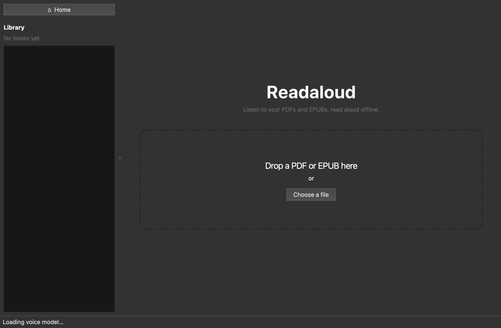

# Readaloud

A desktop app that reads PDFs aloud like an audiobook, using a local, offline text-to-speech engine.



## Features

- **Open a PDF** by dragging it onto the window, with a file picker, or by passing a path on the command line.
- **Clean text extraction** page by page: running headers, footers and page numbers are removed, words split across lines are rejoined, and ligatures (fi, fl) are expanded.
- **Scanned pages are detected.** A page with no text layer gets a clear message and is skipped (there is no OCR).
- **Offline speech** with [Kokoro](https://github.com/hexgrad/kokoro), an 82M-parameter neural TTS model that runs locally.
- **Playback controls:** play, pause, resume, stop, previous/next page, jump to a page and speed (0.5× to 2×).
- **Follow along:** the current page number is shown and the sentence being read is highlighted.
- **Export to MP3 or WAV** for the whole PDF or a page range. Export runs in the background with a progress bar and a cancel button, and the app stays usable meanwhile.
- **Resume where you left off:** the last page reached is saved for each PDF, and the app offers to resume from it when you reopen the file.

## Requirements

- **Python 3.11 or 3.12.** Kokoro 0.9 does not support Python 3.13 yet.
- **ffmpeg**, needed by pydub for MP3 export. WAV export works without it.
- About 2 GB of disk space for PyTorch and the voice model.
- An internet connection **on first run only**: Kokoro downloads its voice model (about 330 MB) from Hugging Face, and its phonemizer downloads the small spaCy English model. After that everything runs offline.

## Installation

### 1. Install Python 3.12 and ffmpeg

macOS (Homebrew):

```bash
brew install python@3.12 ffmpeg
```

Ubuntu / Debian:

```bash
sudo apt install python3.12 python3.12-venv ffmpeg
```

Windows: install Python 3.12 from [python.org](https://www.python.org/downloads/) and ffmpeg from [ffmpeg.org](https://ffmpeg.org/download.html), then make sure `ffmpeg` is on your `PATH`.

### 2. Create a virtual environment and install Readaloud

```bash
git clone https://github.com/<your-username>/readaloud.git
cd readaloud
python3.12 -m venv .venv
source .venv/bin/activate          # Windows: .venv\Scripts\activate
python -m pip install --upgrade pip
python -m pip install -e ".[dev]"
```

## Usage

### Desktop app

```bash
readaloud                 # or: python -m readaloud
readaloud path/to/book.pdf
```

The window opens on a start screen: drag a PDF onto it or click **Choose a PDF…**. The first launch takes a little longer while the voice model loads; the status bar says when it is ready.

Set `READALOUD_LOG_LEVEL=INFO` (or `DEBUG`) to see diagnostic logging in the terminal.

| Control | Shortcut |
| --- | --- |
| Open PDF | Ctrl/Cmd+O |
| Play / Pause / Resume | Space |
| Previous / Next page | Page Up / Page Down |
| Export audio | Ctrl/Cmd+E |

Speed changes take effect from the next sentence.

### Build a double-click app (macOS)

To launch Readaloud from Finder, the Dock or Launchpad with no terminal, build a standalone `Readaloud.app` with PyInstaller:

```bash
python -m pip install -e ".[app]"
python -m spacy download en_core_web_sm   # bundled so the app never needs pip
pyinstaller --noconfirm packaging/readaloud.spec
```

The app appears at `dist/Readaloud.app` (about 1 GB, mostly PyTorch). Drag it into your Applications folder, then open it and drop a PDF onto the window. The voice model is still downloaded on first launch and cached in your user folder. MP3 export uses the system `ffmpeg` (Homebrew's is found automatically).

The same spec builds a `dist/Readaloud/` folder app on Windows and Linux. That build is untested.

### Command line

Synthesize a single page to a WAV file:

```bash
readaloud-cli path/to/book.pdf --page 3 --out page3.wav --speed 1.25
```

### Run the tests

```bash
pytest
```

The tests build their own small PDFs at runtime and use a fake TTS engine, so they run in under a second and need neither the model nor any PDF files.

## Project structure

```
readaloud/
├── src/readaloud/
│   ├── __main__.py       # GUI entry point (readaloud)
│   ├── cli.py            # single-page CLI (readaloud-cli)
│   ├── pdf_extract.py    # PyMuPDF extraction, header/footer/page-number cleaning
│   ├── tts.py            # Kokoro engine wrapper, sentence splitting
│   ├── playback.py       # QAudioSink playback, background synthesis, page logic
│   ├── export.py         # page-range logic, MP3/WAV export
│   ├── export_dialog.py  # export range dialog and worker thread
│   ├── state.py          # per-PDF resume positions
│   └── gui.py            # main window (widgets and wiring only)
├── tests/                # pytest suite; generates its own PDFs
├── packaging/            # PyInstaller spec and launcher for Readaloud.app
├── docs/                 # screenshot
├── pyproject.toml
├── LICENSE
└── README.md
```

The GUI holds no extraction or TTS logic. It calls `pdf_extract`, `playback` and `export`, which can be used and tested on their own.

## Where data is stored

Resume positions live in your platform's user data directory (via `platformdirs`), never inside the repository:

- macOS: `~/Library/Application Support/readaloud/resume_positions.json`
- Linux: `~/.local/share/readaloud/resume_positions.json`
- Windows: `%LOCALAPPDATA%\readaloud\resume_positions.json`

PDFs are identified by a SHA-256 hash of their contents, so the file stores no file names or paths.

## Known limitations

- **No OCR.** Scanned or image-only pages are skipped.
- **English only.** The app uses Kokoro's American English voice `af_heart`. Other languages and voices are not exposed in the UI.
- **Header/footer detection is heuristic.** It removes text in the top and bottom margins that repeats on at least 30% of pages, plus bare page numbers. Unusual layouts can leave a header in or, rarely, drop a repeated line. Multi-column layouts and tables are read in PyMuPDF's block order.
- **Paragraphs that cross a page break** are read as two pieces, with a short pause between them.
- **Speed changes** apply from the next sentence, not mid-sentence.
- **Synthesis speed depends on your CPU/GPU.** On slow machines there can be a short pause between sentences, and exporting a whole book can take a long time.
- **Long exports to MP3** are converted in memory by pydub at the end, which needs RAM roughly the size of the uncompressed audio (about 170 MB per hour). WAV export streams to disk.
- **Install path length:** espeak-ng (used by Kokoro's phonemizer) fails with `Error processing file '.../phontab'` if the virtual environment is in a very deep directory (around 160 characters to the `espeak-ng-data` folder). Use a shorter path if you see this.
- Python 3.13 is not supported because of Kokoro, and pydub relies on the `audioop` module that 3.13 removed.

## License

[MIT](LICENSE)
