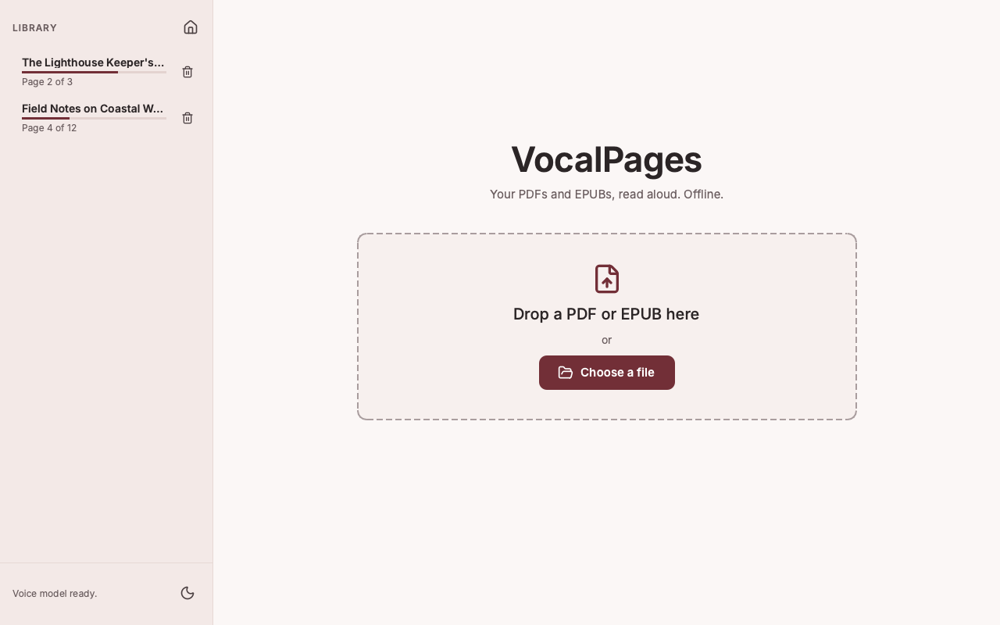
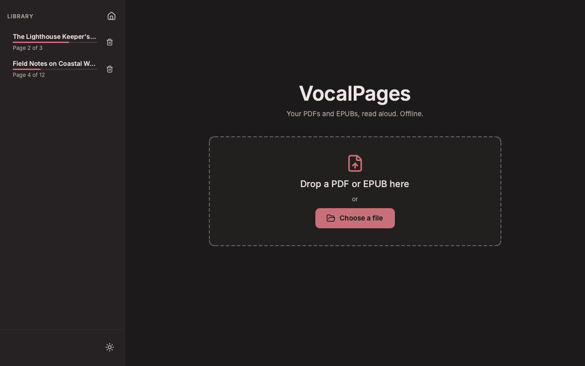
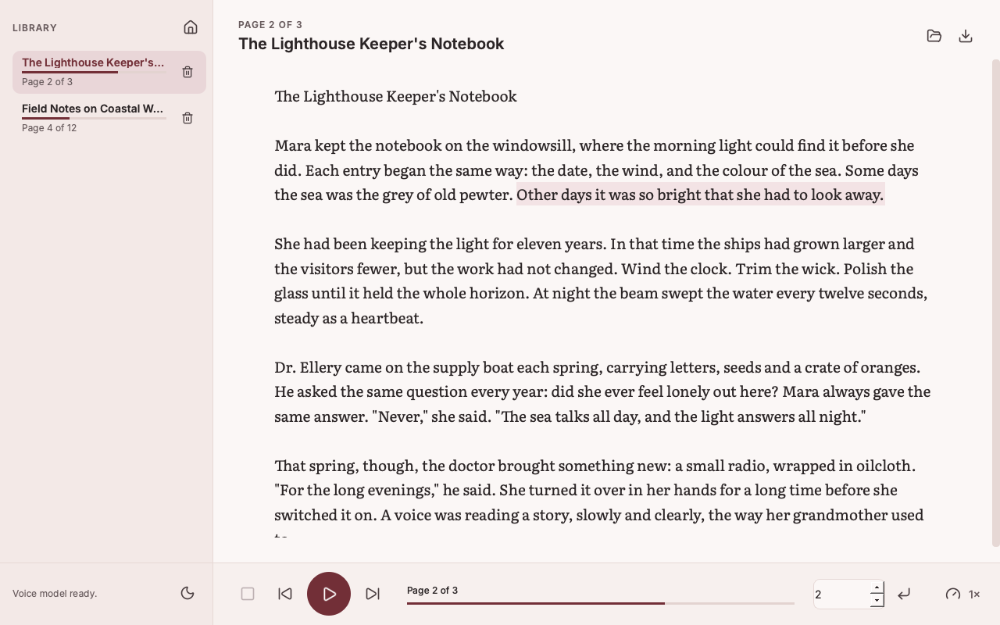
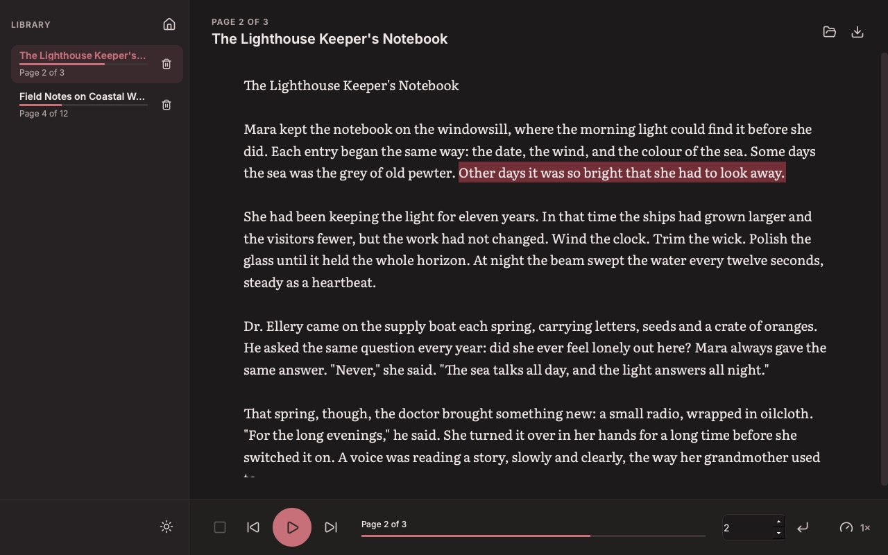

# VocalPages

A desktop app that reads PDF and EPUB books aloud like an audiobook, using a local, offline text-to-speech engine.

| | Light | Dark |
| --- | --- | --- |
| **Home** |  |  |
| **Reader** |  |  |

*Screenshots use a generated sample book; regenerate them with `python scripts/make_screenshots.py`.*

## Features

- **PDF and EPUB.** PDFs are read page by page. EPUBs are read chapter by chapter in spine order, with title and author taken from the book's metadata.
- **Home page and library.** The home page shows a drop area and a **Choose a file** button. Every book you add appears in a sidebar with its progress (for example "Page 40 of 210" or "Ch 3 of 12"). Click a book to continue at the exact sentence where you stopped.
- **Click any sentence** to stop the current audio and start reading from there. The sentence being read is highlighted and kept in view.
- **Clean text.** PDF running headers, footers and page numbers are removed, words split across lines are rejoined, and ligatures (fi, fl) are expanded. EPUB navigation, scripts, styles, images and page-break markers are stripped.
- **Careful sentence splitting** that does not break on abbreviations (Mr., Dr., e.g., i.e.), initials, decimals (3.14) or mid-sentence ellipses.
- **Scanned pages and image-only chapters are detected** and skipped with a clear message (there is no OCR).
- **Offline speech** with [Kokoro](https://github.com/hexgrad/kokoro), an 82M-parameter neural TTS model that runs locally.
- **Playback controls:** play, pause, resume, stop, previous/next page or chapter, jump to a page or chapter, and speed (0.5× to 2×).
- **Calm, readable design:** a wine-red accent on warm neutrals, Literata for the book text (about 19px, 1.6 line height, about 70 characters per line), Inter for the interface, and Lucide icons with tooltips and accessible names on every icon button.
- **Light and dark themes:** the first launch follows your operating system's setting. The sun/moon button at the bottom of the sidebar switches instantly, even during playback, and your choice is remembered.
- **Export to MP3 or WAV** for the whole book or a range of pages or chapters. Export runs in the background with a progress bar and a cancel button, and the app stays usable meanwhile.

## Supported formats

| Format | Unit | Notes |
| --- | --- | --- |
| PDF (`.pdf`) | Page | Needs a text layer; scanned pages are skipped. Password-protected PDFs are not supported. |
| EPUB (`.epub`, EPUB 2 and 3) | Chapter (one per spine document) | DRM-protected EPUBs are detected and rejected with a message. Embedded-font obfuscation is fine. |

## Requirements

- **Python 3.11 or 3.12.** Kokoro 0.9 does not support Python 3.13 yet.
- **ffmpeg**, needed by pydub for MP3 export. WAV export works without it.
- About 2 GB of disk space for PyTorch and the voice model.
- An internet connection **on first run only**: Kokoro downloads its voice model (about 330 MB) from Hugging Face, and its phonemizer downloads the small spaCy English model. After that everything runs offline.

## Installation

### 1. Install Python 3.12 and ffmpeg

macOS (Homebrew):

```bash
brew install python@3.12 ffmpeg
```

Ubuntu / Debian:

```bash
sudo apt install python3.12 python3.12-venv ffmpeg
```

Windows: install Python 3.12 from [python.org](https://www.python.org/downloads/) and ffmpeg from [ffmpeg.org](https://ffmpeg.org/download.html), then make sure `ffmpeg` is on your `PATH`.

### 2. Create a virtual environment and install VocalPages

```bash
git clone https://github.com/<your-username>/vocalpages.git
cd vocalpages
python3.12 -m venv .venv
source .venv/bin/activate          # Windows: .venv\Scripts\activate
python -m pip install --upgrade pip
python -m pip install -e ".[dev]"
```

## Usage

### Desktop app

```bash
vocalpages                 # or: python -m vocalpages
vocalpages path/to/book.pdf
```

The window opens on the home page: drag a PDF or EPUB onto it or click **Choose a file**. The book is added to the library sidebar and opened. Click a sentence to start reading from it. The first launch takes a little longer while the voice model loads; the status bar says when it is ready.

Adding a book that is already in the library (same contents, any file name) opens the existing entry. To remove a book, click its **✕** or right-click it and choose **Remove from library…**. This only removes VocalPages' copy and your reading position; your original file is never touched.

Set `VOCALPAGES_LOG_LEVEL=INFO` (or `DEBUG`) to see diagnostic logging in the terminal.

| Control | Shortcut |
| --- | --- |
| Open a book | Ctrl/Cmd+O (or the folder icon) |
| Play / Pause / Resume | Space |
| Previous / Next page or chapter | Page Up / Page Down |
| Export audio | Ctrl/Cmd+E |

Speed changes take effect from the next sentence.

### Build a double-click app (macOS)

To launch VocalPages from Finder, the Dock or Launchpad with no terminal, build a standalone `VocalPages.app` with PyInstaller:

```bash
python -m pip install -e ".[app]"
python -m spacy download en_core_web_sm   # bundled so the app never needs pip
pyinstaller --noconfirm packaging/vocalpages.spec
```

The app appears at `dist/VocalPages.app` (about 1 GB, mostly PyTorch). Drag it into your Applications folder, then open it and drop a PDF or EPUB onto the window. The voice model is still downloaded on first launch and cached in your user folder. MP3 export uses the system `ffmpeg` (Homebrew's is found automatically).

The same spec builds a `dist/VocalPages/` folder app on Windows and Linux. That build is untested.

### Command line

Synthesize a single page (PDF) or chapter (EPUB) to a WAV file:

```bash
vocalpages-cli path/to/book.pdf --page 3 --out page3.wav --speed 1.25
vocalpages-cli path/to/book.epub --chapter 2 --out chapter2.wav
```

### Run the tests

```bash
pytest
```

The tests build their own small PDFs and EPUBs at runtime and use a fake TTS engine and a temporary library folder, so they run in about a second and need neither the model nor any of your books.

## Project structure

```
vocalpages/
├── src/vocalpages/
│   ├── __main__.py       # GUI entry point (vocalpages)
│   ├── cli.py            # single page/chapter CLI (vocalpages-cli)
│   ├── document.py       # shared Document/Section model, load_document()
│   ├── pdf_extract.py    # PDF loader: PyMuPDF, header/footer/page-number cleaning
│   ├── epub_extract.py   # EPUB loader: spine order, HTML cleaning, DRM detection
│   ├── sentences.py      # regex sentence splitter, sentence positions
│   ├── tts.py            # Kokoro engine wrapper
│   ├── playback.py       # QAudioSink playback, background synthesis, reading position
│   ├── export.py         # range logic, MP3/WAV export
│   ├── library.py        # SQLite library, book copies, positions, migration
│   ├── settings.py       # saved user settings (theme choice)
│   ├── theme.py          # design tokens, both palettes, the app stylesheet
│   ├── icons.py          # themed Lucide SVG icons
│   ├── gui.py            # main window (widgets and wiring only)
│   ├── home.py           # home page widget
│   ├── sidebar.py        # library sidebar widget
│   ├── reader_view.py    # reading pane: text column, highlight, smooth scroll
│   ├── export_dialog.py  # export range dialog and worker thread
│   └── assets/           # bundled Lucide icons and Inter/Literata fonts, with licenses
├── tests/                # pytest suite; generates its own PDFs and EPUBs
├── packaging/            # PyInstaller spec and launcher for VocalPages.app
├── scripts/              # make_screenshots.py (offscreen, generated sample book)
├── docs/screenshots/     # README screenshots
├── pyproject.toml
├── LICENSE
└── README.md
```

Both loaders produce the same `Document` (metadata plus numbered sections, each split into sentences), so playback, export and the library never need to know whether a book came from a PDF or an EPUB. The GUI modules hold no parsing or TTS logic, and no styling either: every color, font size, spacing value and radius is a token in `theme.py`, applied through one stylesheet. Both palettes define the same tokens, so widgets never need to know which theme is active.

## Where data is stored

The library lives in your platform's user data directory (via `platformdirs`), never inside the repository:

| OS | Folder |
| --- | --- |
| macOS | `~/Library/Application Support/vocalpages/` |
| Linux | `~/.local/share/vocalpages/` (or `$XDG_DATA_HOME/vocalpages/`) |
| Windows | `%LOCALAPPDATA%\vocalpages\` |

Inside it:

- `library.sqlite3`: one row per book with its title, author, format, progress and reading position (page or chapter, plus sentence).
- `settings.json`: your theme choice. It only exists after you use the theme toggle.
- `books/`: VocalPages' own copy of each book, named by the SHA-256 of its contents. The library keeps working if you move or delete the original file.

Only the original file *name* is stored for reference, never its folder path. To reset everything, quit the app and delete that folder.

**Upgrading from Readaloud** (this app's earlier name): on first launch, VocalPages copies your library, book copies and reading positions from the old `readaloud` data folder into the new `vocalpages` one. The old folder is left untouched.

**Upgrading from an earlier version:** positions saved in the old `resume_positions.json` are imported automatically on first start. A book picks up its saved page the first time you add that same file again. The old file is left in place.

## Known limitations

- **Following the OS theme** relies on Qt reporting the system color scheme (Qt 6.5+). This works on macOS and Windows 10/11. On some Linux desktops Qt reports "unknown", and the app starts in the light theme.
- **No OCR.** Scanned or image-only pages are skipped.
- **EPUB chapters follow the book's files.** Each spine document is one chapter. Some books put several chapters in one file (or split one chapter across files), so "chapter" counts and export ranges follow the file layout, not necessarily the printed chapters.
- **DRM-protected EPUBs** (Adobe, Apple, Kindle conversions with DRM) cannot be read.
- **Sentence splitting is rule-based.** It handles common English abbreviations, initials, acronyms, decimals and ellipses, but an unusual abbreviation followed by a capitalised word can still split a sentence in two, or join two sentences.
- **English only.** The app uses Kokoro's American English voice `af_heart`. Other languages and voices are not exposed in the UI.
- **Header/footer detection is heuristic.** It removes text in the top and bottom margins that repeats on at least 30% of pages, plus bare page numbers. Unusual layouts can leave a header in or, rarely, drop a repeated line. Multi-column layouts and tables are read in PyMuPDF's block order.
- **Paragraphs that cross a PDF page break** are read as two pieces, with a short pause between them.
- **Speed changes** apply from the next sentence, not mid-sentence.
- **Synthesis speed depends on your CPU/GPU.** On slow machines there can be a short pause between sentences, and exporting a whole book can take a long time.
- **Long exports to MP3** are converted in memory by pydub at the end, which needs RAM roughly the size of the uncompressed audio (about 170 MB per hour). WAV export streams to disk.
- **Install path length:** espeak-ng (used by Kokoro's phonemizer) fails with `Error processing file '.../phontab'` if the virtual environment is in a very deep directory (around 160 characters to the `espeak-ng-data` folder). Use a shorter path if you see this.
- Python 3.13 is not supported because of Kokoro, and pydub relies on the `audioop` module that 3.13 removed.

## Design and credits

- Palettes meet WCAG AA contrast (4.5:1 for text, 3:1 for icons) in both themes, and `tests/test_theme.py` checks every pair. The light accent is the wine red `#722F37`. Dark mode uses a lighter wine, `#C8707A`, for text and icons, and `#722F37` as the sentence-highlight background.
- Errors never rely on color alone: they always show an alert icon with the message.
- Icons: [Lucide](https://lucide.dev) (ISC license, see `src/vocalpages/assets/icons/LICENSE`).
- Fonts: [Inter](https://github.com/rsms/inter) and [Literata](https://github.com/googlefonts/literata), both under the SIL Open Font License 1.1 (license files in `src/vocalpages/assets/fonts/`).

## License

[MIT](LICENSE)
